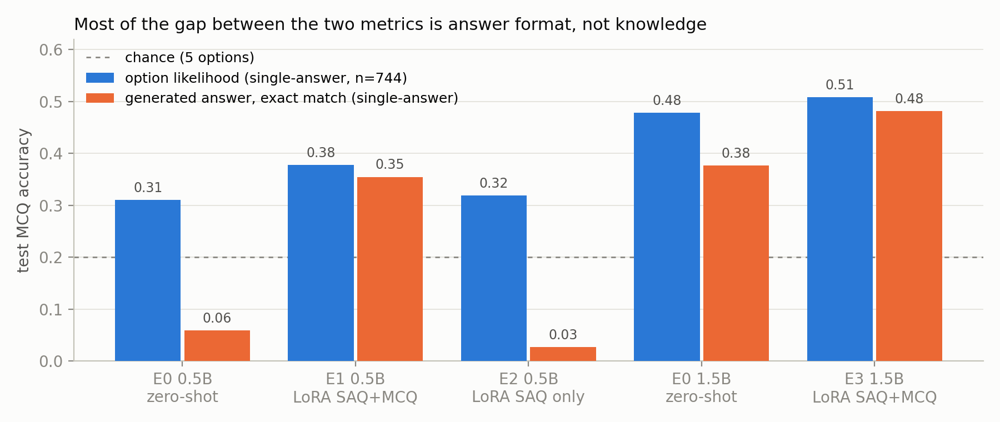
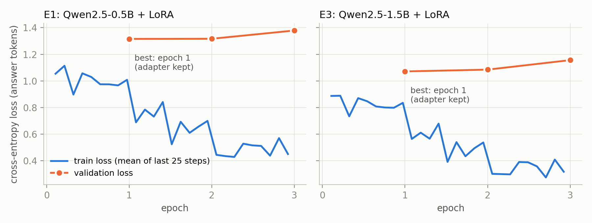

# AfriMed Assistant: Fine-Tuning a Small Open Language Model for Medical Question Answering in African Contexts

**Author:** Orrie-Dan · African Leadership University · Machine Learning Techniques I, Summative Project (Option 1: Domain-Specific QA Assistant)

**Project links**

| | |
|---|---|
| GitHub repository | https://github.com/Orrie-Dan/afrimed-qa-assistant |
| Demo video (7–10 min) | https://youtu.be/r-1iQLhY5ek |
| Live system | https://huggingface.co/spaces/OrrieUzi/afrimed-assistant (Hugging Face Spaces, CPU) |

> **[AUTHOR TO COMPLETE: statement on AI assistance.]** If ALU's policy requires it, state here which parts of the work used AI tools (for example code drafting and report drafting) and confirm that you checked, ran and can explain all submitted work.

---

## 1. Abstract

Medical question answering (QA) systems built on large language models (LLMs) are usually trained and evaluated on data from high-income countries. They are rarely tested on the diseases, health systems and phrasing found in African healthcare settings.

This project builds an English medical QA assistant for African contexts:
- **Model:** a small open model, Qwen2.5-Instruct (0.5B and 1.5B parameters), fine-tuned with Low-Rank Adaptation (LoRA).
- **Data:** AfriMed-QA, a pan-African medical QA dataset written by contributors from 16 countries.
- **Split:** the official split places all expert-written questions in the test set, so I created a documented, stratified re-split of the 5,263 answered questions after quality filtering.

**Evaluation and main results.** Against zero-shot baselines, the deployed model (1.5B + LoRA) reaches 0.454 exact-set accuracy on 806 test multiple-choice questions (MCQs), compared with 0.360 zero-shot. It reaches ROUGE-L 0.330 and BERTScore 0.316 on 246 short-answer questions (SAQs), compared with 0.177 and 0.160 zero-shot.

**A format-independent check.** I added an MCQ metric that reads which option the model rates most likely, together with paired McNemar tests. This showed that at 1.5B most of the MCQ gain comes from the model learning to commit to a single answer: the knowledge-level gain (0.479 → 0.508) is not statistically significant. Model size was the largest effect. Several high-overlap short answers were also factually wrong, so a blind manual correctness and safety rating complements the automatic metrics.

**The deployed system** combines:
- a rule-based crisis check;
- a TF-IDF + logistic-regression out-of-domain gate, with 0.984 balanced accuracy on the test set and 0.84 on a held-out hand-written probe set;
- the fine-tuned model, served on a free Hugging Face CPU Space (median answer time 15.8 s).

**Conclusion.** Parameter-efficient fine-tuning makes a small model a usable, focused assistant. In this setting, though, it mostly changes how the model answers rather than what it knows. Deployment therefore needs safeguards and honest communication of its limits.

## 2. Introduction

**The problem.** Access to qualified health professionals is uneven across sub-Saharan Africa. The region also carries a disproportionate share of some disease burdens: for example, the WHO African Region accounted for about 94% of malaria cases and 95% of malaria deaths worldwide in 2023 (World Health Organization [WHO], 2024).

LLM-based assistants could help people find health information. However, the medical QA benchmarks used to develop them come mainly from the United States, China and India:
- MedQA, from licensing exams (Jin et al., 2021);
- MedMCQA, from Indian entrance exams (Pal et al., 2022);
- PubMedQA, from biomedical abstracts (Jin et al., 2019).

Olatunji et al. (2025) found that LLM performance on African medical questions varies significantly across specialties and geographies, and that MCQ performance "clearly lags USMLE (MedQA)".

**Why this task and this language.** The task is open-ended medical QA in **English**, which is a working language of clinical education and practice in the countries that contribute most of AfriMed-QA (Nigeria, Kenya, South Africa, Ghana). English lets the project use a strong open base model and an established, expert-curated dataset. The African focus comes from the content: local disease patterns, health-system realities and question phrasing.

**Target users.** Health-information seekers, and students revising for medical exams, in African settings. The system is explicitly **not** a diagnostic or treatment tool.

**Objective.** To build and evaluate a small, deployable QA assistant that:
1. answers human-health questions in African contexts better than its own zero-shot baseline;
2. declines questions outside its domain;
3. can be served on free, CPU-only hosting.

**Research questions.** Alongside the system, the project asks:
- **RQ1:** How much does LoRA fine-tuning on AfriMed-QA improve a small model over zero-shot use?
- **RQ2:** Does model size (0.5B vs 1.5B) matter more than fine-tuning?
- **RQ3:** Does the type of training data (SAQ only vs SAQ + MCQ) matter?
- **RQ4:** Does fine-tuning change what the model *knows*, or mainly how it *answers*?

## 3. Related Work

**Medical QA benchmarks.** Medical QA has been studied mainly through exam-style multiple-choice datasets:
- **MedQA:** USMLE and Chinese licensing exams (Jin et al., 2021).
- **MedMCQA:** about 194k Indian entrance-exam questions (Pal et al., 2022).
- **PubMedQA:** yes/no/maybe questions over research abstracts (Jin et al., 2019).

These made progress measurable, but they reflect the curricula and health systems of the places they come from. **AfriMed-QA** (Olatunji et al., 2025) addresses this gap. It has about 15,000 English questions (MCQs, SAQs and consumer queries), sourced from over 60 medical schools across 16 countries and covering 32 specialties, and the authors evaluated 30 LLMs on it. They report that biomedical LLMs underperform general models, and that "smaller edge-friendly LLMs struggle to achieve a passing score". My project builds on this dataset and moves from benchmarking to fine-tuning and deploying a small model.

**Medical LLMs.** There are two broad routes to medical LLMs:
- **Scaling and instruction-tuning very large models.** Med-PaLM and Med-PaLM 2 (Singhal et al., 2023a, 2023b) reached expert-level MedQA scores. Their authors stressed that multiple-choice accuracy is insufficient and used physician ratings for long-form answers.
- **Domain-adaptive pre-training of open models.** This includes BioMistral-7B (Labrak et al., 2024) and MEDITRON-70B (Chen et al., 2023).

Both routes need GPU resources far beyond a free CPU server. My project targets the opposite end: a 1.5B model that can run on free CPU hosting.

**Parameter-efficient fine-tuning.** LoRA (Hu et al., 2022) freezes the pre-trained weights and learns low-rank updates to selected weight matrices. This reduces the number of trainable parameters by orders of magnitude while matching full fine-tuning on many tasks. QLoRA (Dettmers et al., 2023) adds 4-bit quantisation of the frozen model; it was not needed here, because the 1.5B model fits a T4 GPU in fp16. I use the Hugging Face Transformers and PEFT libraries (Wolf et al., 2020; Mangrulkar et al., 2022), built on PyTorch (Paszke et al., 2019), with Qwen2.5-Instruct (Qwen Team, 2024).

**What fine-tuning teaches.** Two findings from the literature help interpret my results:
- Zhou et al. (2023) proposed the "superficial alignment hypothesis": a model's knowledge is learned in pre-training, and fine-tuning mostly teaches the format and style of responses.
- Gekhman et al. (2024) showed that fine-tuning on facts the model does not already know is learned slowly, and that it increases the model's tendency to hallucinate. They found early stopping reduced this.

These findings motivate RQ4 and inform the error analysis.

**Evaluating generated text.** ROUGE (Lin, 2004) measures n-gram overlap with a reference, and BERTScore (Zhang et al., 2020) measures similarity of contextual embeddings. Neither measures factual correctness (Ji et al., 2023), which is why medical studies add human ratings (Singhal et al., 2023a). Greedy decoding from language models is also known to produce repetitive, degenerate text (Holtzman et al., 2020).

**Out-of-domain detection and shortcut learning.** Deployed classifiers should recognise inputs outside their training distribution (Hendrycks & Gimpel, 2017). Text classifiers often exploit superficial cues ("shortcuts") instead of the intended signal (Geirhos et al., 2020; Gururangan et al., 2018). I found exactly this in the first version of my gate (Section 6.4).

**The gap this project addresses.** Prior work either benchmarks large models on African medical QA (Olatunji et al., 2025) or builds large medical models. Little work shows whether a *small*, deployable model fine-tuned on African medical data actually improves, and in what way. This project answers that with controlled experiments, a format-independent metric, significance tests and a deployed system with explicit safeguards.

## 4. Dataset and Data Preparation

### 4.1 Source

AfriMed-QA v2.5 was taken from the authors' GitHub repository (`intron-innovation/AfriMed-QA`, commit `9bb0ffc`). The file has 15,275 rows and 30 columns and is checked by SHA-256 before use.

The repository is licensed **CC-BY-NC-SA-4.0**. The Hugging Face copy (v2.4) is gated and lists CC-BY-SA-4.0. I follow the stricter licence, so the project is non-commercial.

| Question type | Rows | Answer available | Authors |
|---|---|---|---|
| Consumer queries | 10,000 | no (169 have a rationale) | crowdsourced |
| Multiple choice (5 options) | 4,039 | correct option key(s) | 3,910 expert, 129 crowdsourced |
| Short answer | 1,236 | free-text reference | 359 expert, 877 crowdsourced |

The answered questions come mainly from Nigeria, Ghana, Kenya, Malawi and South Africa, and cover 38 specialty labels.

### 4.2 Characteristics and quality issues found

I profiled the data before any modelling (`docs/data_findings.md`):

1. **The official split separates authors.** Every expert-written MCQ and SAQ is in the official test set, and the official training set contains only 1,006 answered (crowdsourced) items. Training on it would test the model on a different population of authors.
2. **315 MCQs (7.8%) have several correct options**, almost all of them expert-written.
3. **The two tiers differ strongly in style.**
   - Crowdsourced SAQs are generic and templated: "What is the primary …" opens 103 of them, and answers are about 29 words.
   - Expert SAQs are clinical. Their answers range from one word ("Alpha-fetoprotein") to 900-word essays.
4. **Label noise.** Some references are wrong. For example, a 4-week-old with projectile, non-bilious vomiting is labelled "duodenal atresia", whereas the textbook answer is pyloric stenosis. There are also a few malformed MCQs, such as an essay prompt with all options "N/A".
5. **Duplicates and quality flags.** 225 groups of duplicate consumer queries were found, 73 of them spanning the official splits. 11 answered rows and 477 consumer rows are flagged `quality == False`.

### 4.3 Preparation (`scripts/prepare_data.py`)

- **Filtering:** I dropped `quality == False` rows and exact duplicates after text normalisation. This left 5,263 answered questions.
- **Split:** 70/10/20 train/validation/test, stratified by *question type × author tier × multi-answer*, with seed 42. The result is 3,685 / 526 / 1,052 questions. The test set has 806 MCQs (781 expert) and 246 SAQs (72 expert).
- **Checks:** no ID overlap between splits, and rerunning the script produces byte-identical files.
- **Consumer queries** (unanswered) were deduplicated and split 7,208 / 901 / 901. They are used only as in-domain examples for the out-of-domain gate.

**Why the dataset is appropriate.** It is real, expert-curated and African in origin, and it covers both exam-style and patient-style questions. Its weaknesses are the small number of answered questions, label noise, and a split by tier that confounds style with expertise. These are documented and handled through the re-split and through per-tier reporting.

### 4.4 Data for the out-of-domain gate

The gate needs non-medical questions. Every negative example is a real question from a public dataset:
- **AfriQA** (Ogundepo et al., 2023): Africa-related questions, so that "mentions Africa" cannot become a shortcut for "medical".
- **TAT-QA** (Zhu et al., 2021): financial-report questions.
- **SQuAD v1.1** (Rajpurkar et al., 2016): general Wikipedia questions.
- **Dolly-15k** (Conover et al., 2023): conversational and instruction-style requests.
- **KisanVaani agriculture QA** (KisanVaani, n.d.): crop and livestock questions.

Medical content inside these sources was removed so that it would not be labelled "non-medical". This covered 25 medical SQuAD articles and questions matching a medical term list, and every removal is logged. In total the gate data has 27,923 / 7,270 / 7,210 examples (train/val/test). Two small hand-written probe sets (62 and 57 questions) are used **only for evaluation**; the second was written before the final gate was trained and scored once. All raw files are pinned to exact revisions with checksums (`data/raw_manifest.json`).

## 5. Methodology

### 5.1 Task formulation

All questions are answered **generatively** through the model's chat template, using a fixed system prompt that asks for accurate, concise answers. The model receives the question; for an MCQ it also receives the options, labelled A–E. It produces:
- for an MCQ: `Answer: B`, or `Answer: B, D` when several options are correct;
- for an SAQ: free text.

One model therefore serves both exam-style questions and the open questions users type into the app.

### 5.2 Baseline

The baseline is the **same pre-trained instruction-tuned model, used zero-shot** with the identical prompt (E0). It is evaluated at both sizes. This isolates exactly what fine-tuning adds, with no change of architecture, tokenizer or prompt.

### 5.3 Model

**Base model.** Qwen2.5-Instruct (Qwen Team, 2024) is a decoder-only Transformer. It uses rotary position embeddings, SwiGLU feed-forward layers, RMSNorm and grouped-query attention, with a byte-level BPE tokenizer of about 151k tokens. It was chosen because:
- it is open and licensed for research;
- it is instruction-tuned and multilingual;
- it is available at 0.5B and 1.5B parameters, small enough to fine-tune on a free T4 GPU and to serve on a CPU.

**LoRA.** For a frozen weight matrix *W*, LoRA (Hu et al., 2022) learns an update *ΔW = BA*, with *A* ∈ ℝ^{r×k} and *B* ∈ ℝ^{d×r}, scaled by *α/r*. *B* starts at zero, so training begins exactly at the base model. I apply LoRA to all attention projections (q, k, v, o) and MLP projections (gate, up, down), with:
- *r* = 16, *α* = 32, dropout 0.05;
- **8.8M trainable parameters** for 0.5B and **18.5M** for 1.5B, about 1–2% of the model's parameters.

### 5.4 Training procedure (`src/afrimed/train.py`)

**Loss.** Causal language-modelling cross-entropy, computed **on the answer tokens only**. The system and user prompt tokens are masked with −100, so the model learns to answer, not to reproduce questions.

**Hyperparameters.** These were chosen from a T4 benchmark of memory and throughput (`docs/benchmark_t4.md`):

| Setting | Value | Why |
|---|---|---|
| max length | 512 tokens | covers 99.86% of training examples (p99 = 338) |
| micro-batch × gradient accumulation | 4 × 4 = effective 16 | batch 8 ran out of memory at 1.5B; at 0.5B it doubled memory for about 10% more throughput |
| optimiser, learning rate | AdamW, 2e-4, cosine decay, 5% warm-up | common LoRA setting |
| epochs | 3, keeping the adapter with the best validation loss | guards against overfitting |
| precision | fp16 autocast, fp32 LoRA weights, gradient checkpointing, gradient clipping at 1.0 | the T4 has no bf16 |
| seed | 42 | reproducibility |

**Compute.** The 1.5B model trained for 693 optimiser steps in 34.5 minutes on one Colab T4.

### 5.5 Evaluation design

- **MCQ, generative exact-set accuracy.** The predicted set of letters must equal the gold set, so multi-answer questions are scored strictly. A parser extracts letters from free text and is self-tested before each run; parse failures were at most 0.9%.
- **MCQ, option-likelihood accuracy** (a metric I added). For each single-answer MCQ, it takes the option letter with the highest next-token score after the prompt `Answer:`. This measures which option the model *prefers*, independently of whether it follows the output format. It needs only one forward pass, and the adapters are reused without retraining.
- **SAQ:** ROUGE-L F1 (Lin, 2004) and BERTScore F1 (roberta-large, rescaled with baseline; Zhang et al., 2020).
- **Uncertainty and significance:**
  - 95% bootstrap confidence intervals (1,000 resamples).
  - Exact two-sided **McNemar tests** on paired per-question correctness (McNemar, 1947), with a Bonferroni-corrected threshold of p < 0.005 for 10 tests (Dunn, 1961).
- **Selection rule:** model choice uses validation data only; test results are reported, never used to choose.
- **Manual rating:** 40 test SAQs (20 expert, 20 crowdsourced). The deployed model and the zero-shot 1.5B model are rated **blind**, with randomised A/B order. Correctness is scored 0/1/2 and unsafe yes/no, judged on medical facts rather than agreement with the reference (`docs/rating_guide.md`).

### 5.6 Out-of-domain gate (`src/afrimed/gate.py`)

**Model.** TF-IDF features (Salton & Buckley, 1988), using word 1–2-grams and character 2–5-grams, fed into logistic regression with balanced class weights (scikit-learn; Pedregosa et al., 2011).

**Why this model.** It is fast and transparent, so its learned features can be inspected, and it has no extra model download for the CPU app.

**Selection.** The feature set and regularisation strength C were chosen by validation balanced accuracy, and the decision threshold by maximising validation balanced accuracy. The final gate uses word+char features, C = 3, threshold 0.40.

## 6. Experiments and Results

### 6.1 Experiments

| ID | Model | Training data | Question it answers |
|---|---|---|---|
| E0 | Qwen2.5-0.5B / 1.5B, zero-shot | none | baselines |
| E1 | 0.5B + LoRA | SAQ + MCQ (3,685) | RQ1: effect of fine-tuning |
| E2 | 0.5B + LoRA | SAQ only (861) | RQ3: effect of training data |
| E3 | 1.5B + LoRA | SAQ + MCQ | RQ2: model size (and the deployed model) |

### 6.2 Main results

**Table 1. Test results.** 95% bootstrap CIs in brackets. MCQ-L is option-likelihood accuracy on 744 single-answer MCQs; MCQ-G is generative exact-set accuracy on all 806 MCQs.

| Run | MCQ-L | MCQ-G | Multi-letter rate³ | SAQ ROUGE-L | SAQ BERTScore | Words/answer | Val MCQ-L | Val ROUGE-L |
|---|---|---|---|---|---|---|---|---|
| E0 0.5B | 0.311 [0.281, 0.341] | 0.056 | 74% | 0.167 [0.155, 0.179] | 0.133 | 134 | 0.339 | 0.165 |
| E0 1.5B | 0.479 [0.444, 0.512] | 0.360 | 23% | 0.177 [0.163, 0.190] | 0.160 | 136 | 0.519 | 0.168 |
| E1 0.5B LoRA | 0.378 [0.344, 0.410] | 0.330 | 7% | 0.289 [0.266, 0.312] | 0.246 | 47 | 0.403 | 0.261 |
| E2 0.5B LoRA, SAQ only | 0.319 [0.285, 0.352] | 0.030 | 85% | **0.331** [0.306, 0.353] | 0.314 | 36 | 0.325 | 0.289 |
| **E3 1.5B LoRA** | **0.508** [0.472, 0.542] | **0.454** | 4% | 0.330 [0.306, 0.355] | **0.316** | 39 | **0.551** | **0.298** |

³ The share of single-answer test MCQs where the generated answer listed more than one letter.

E3 is best on both validation metrics, so it was selected for deployment. Reference SAQ answers have a median of about 29 words.

**Figure 1.** Test MCQ accuracy on single-answer questions, measured by option likelihood (blue) and by generated answer (orange). The large gaps for E0-0.5B and E2 are caused by multi-letter answers, not lack of knowledge.

**Table 2. Paired McNemar tests on test MCQs.** "Only A / only B" counts the questions where just one of the two models is correct. Significant means p < 0.005.

| Comparison (A → B) | Metric | Accuracy A → B | Only A / only B | p | Significant |
|---|---|---|---|---|---|
| Fine-tuning at 0.5B (E0 → E1) | MCQ-L | 0.311 → 0.378 | 78 / 128 | 0.0006 | yes |
| | MCQ-G | 0.056 → 0.330 | 16 / 237 | < 1e-5 | yes |
| Fine-tuning at 1.5B (E0 → E3) | MCQ-L | 0.479 → 0.508 | 71 / 93 | 0.101 | **no** |
| | MCQ-G | 0.360 → 0.454 | 69 / 145 | < 1e-5 | yes |
| Size, both fine-tuned (E1 → E3) | MCQ-L | 0.378 → 0.508 | 73 / 170 | < 1e-5 | yes |
| | MCQ-G | 0.330 → 0.454 | 67 / 167 | < 1e-5 | yes |
| Training data (E1 → E2) | MCQ-L | 0.378 → 0.319 | 125 / 81 | 0.003 | yes (E1 better) |
| | MCQ-G | 0.330 → 0.030 | 255 / 13 | < 1e-5 | yes (E1 better) |
| Size vs fine-tuning (E0 1.5B → E1) | MCQ-L | 0.479 → 0.378 | 172 / 97 | 1e-5 | yes (E0 1.5B better) |
| | MCQ-G | 0.360 → 0.330 | 149 / 125 | 0.165 | no |

**Figure 2.** Training loss (mean of the last 25 optimiser steps) and validation loss per epoch. Validation loss is lowest after epoch 1 for both models and rises afterwards while training loss keeps falling. The epoch-1 adapter was kept.

### 6.3 Interpretation

- **RQ1 (fine-tuning).**
  - Fine-tuning significantly improves how both models answer MCQs (generative accuracy). It roughly doubles SAQ overlap scores, with non-overlapping CIs.
  - At 0.5B it also significantly raises option-likelihood accuracy (+6.7 points).
  - At 1.5B the likelihood gain (+3.0 points) is not significant. The generative gain there comes mostly from the model learning to commit to one option: multi-letter answers fell from 23% to 4%.
- **RQ2 (size).** Size is the largest and most reliable effect. Even zero-shot 1.5B knows more than fine-tuned 0.5B (MCQ-L 0.479 vs 0.378, p = 1e-5).
- **RQ3 (training data).**
  - Training only on SAQs (E2) gives the best SAQ scores at 0.5B, but those are within the CIs of E3.
  - E2 destroys MCQ answering: 85% of its answers list several letters.
  - Including MCQs (E1) also gives significantly better option-likelihood accuracy than E2. MCQ training data therefore teaches more than the output format.
- **RQ4 (knowing vs answering).** At 1.5B, fine-tuning changes the answer *format and style* much more than the model's *preferences between options*. Answers become shorter (136 → 39 words) and more templated, and MCQ answers commit to one letter. This is consistent with the superficial alignment hypothesis (Zhou et al., 2023).
  - The SAQ gains concentrate in crowdsourced questions, where ROUGE-L rose from 0.21 to 0.40 for E0 1.5B vs E3. Expert questions rose only from 0.10 to 0.16. This is further evidence that much of the SAQ improvement is the learned house style of the crowdsourced data.
- **Overfitting.** Validation loss was lowest after epoch 1 (Figure 2). One pass over 3,685 examples is enough for LoRA to learn the format. Further epochs fit the training answers more closely without generalising. This also fits Gekhman et al.'s (2024) finding that later fine-tuning on unfamiliar facts encourages hallucination, and that early stopping helps.
- **Context.** On the official AfriMed-QA MCQ test set (3,910 expert questions), the dataset authors report about 0.79 for GPT-4o, 0.62 for Llama-3.1-8B-Instruct and 0.44 for BioMistral-7B (AfriMed-QA repository results; Olatunji et al., 2025). These are not directly comparable, because our test set is a different, smaller sample from the same pool. Still, E3's 0.454 places a 1.5B model trained on about 2.8k MCQs in the range of 7B biomedical models.

### 6.4 Out-of-domain gate

| | Gate v1: AfriQA + TAT-QA + SQuAD negatives | Gate v2: + Dolly + agriculture (deployed) |
|---|---|---|
| Test balanced accuracy | 0.990 | 0.984 |
| Africa-mentioning non-medical questions declined | 99.5% | 99.0% |
| Held-out probe balanced accuracy (n = 57) | **0.668** | **0.839** |

**Shortcut learning in v1.** The first gate scored 0.99 on test but only 0.67 on the held-out probe. Its most "medical" features were *my*, *it*, *you*, *should* and *the following*; its most "non-medical" features were *who*, *when* and *how many*. Because every negative example was a factoid or finance question, the gate learned **phrasing**, not medicine (Geirhos et al., 2020; Gururangan et al., 2018). "Tell me a joke", "hello" and "How do I bake a cake?" were therefore classed as medical.

**The fix.** Adding real conversational and instruction-style negatives (Dolly) and agriculture questions raised the held-out probe score to 0.84. Accuracy on the general/chit-chat category rose from 0.20 to 0.90.

**Remaining errors** (held-out probe):
- Animal-health questions with symptoms ("My goats are coughing…") are still treated as medical.
- Some health questions without clinical wording are declined. The most serious is "How can I help a friend who talks about suicide?" (P(medical) = 0.03), which motivated the crisis rule (Section 8).

The probe sets are small, so their scores carry wide uncertainty (roughly ±0.1).

## 7. Error Analysis and Discussion

### 7.1 Where the model does well

- **Short, factual, templated questions,** especially crowdsourced ones:
  - "What is the most common type of anemia in African children under five?" got "Iron deficiency anemia…" (ROUGE-L 0.74).
  - Prevention and public-health questions (HPV vaccination, malnutrition) got concise answers in the style of the references.
- **MCQs where the model commits to one answer.** For a bacterial vaginosis question, the zero-shot model answered "C, D", while the fine-tuned model answered "A", which is correct.
- **In the live app,** answers on malaria symptoms in children, hypertension treatment and iron-rich foods in pregnancy were reasonable and appropriately short.

### 7.2 Where it fails, and why

1. **Confident factual errors, often in the reference's sentence pattern.**
   - "Which parasitic infection is a leading cause of seizures in Africa?" got "Schistosomiasis, caused by…" with ROUGE-L 0.74; the reference says cerebral malaria.
   - In the live app: "Primaquine is the first-line treatment for uncomplicated malaria in Nigeria." WHO recommends artemisinin-based combination therapy (ACT) as first-line; primaquine is only added as a single low dose to reduce transmission in some settings (WHO, n.d.).

   *Why:* fine-tuning taught the answer template ("X, caused by Y, is a leading cause of Z in Africa") faster than it taught facts, which matches RQ4. The model fills the template with a plausible but wrong entity: a hallucination in the sense of Ji et al. (2023). It is also exactly the kind of error that ROUGE-L rewards.
2. **Regressions from fine-tuning.** "African race is a modifiable risk factor for hypertension. True or False?" got "True" from the fine-tuned model and "False" (correct) from the zero-shot model. "Leading infectious cause of blindness in Africa?" got "Malaria" from the fine-tuned model; zero-shot said "Trachoma", which is defensible. Shorter, committed answers remove the hedging that sometimes contained the right answer.
3. **Repetition loops.** Examples: a total-gastrectomy answer repeating "Hypertriglyceridemia", and in the live app, pre-eclampsia signs ("• Severe headache • Severe abdominal pain • Severe headache …"). This is a known failure of greedy decoding in small models (Holtzman et al., 2020). List-style expert references in training may make it worse.
4. **Expert SAQs remain hard.** ROUGE-L is only 0.16 even for E3. Expert references vary from one word to essays, and they need clinical reasoning that a 1.5B model trained on 861 SAQs does not acquire.
5. **Format confusion without MCQ training.** E2 answered 85% of single-answer MCQs with several letters (Figure 1). The SAQ-only model never learned that one letter is expected.
6. **Noisy references.** Some "errors" are reference errors, such as the duodenal-atresia label in Section 4.2. This is another reason why rating must judge medical facts, not agreement with the reference.

### 7.3 Manual correctness and safety rating

> **[TO COMPLETE after rating]** Run `python -P scripts/score_ratings.py`, then fill in the table and the paragraph.

**Table 3. Blind manual rating, 40 test SAQs.**

| Model | Correct (2) | Partly (1) | Wrong (0) | Unsafe | Mean (0–2) |
|---|---|---|---|---|---|
| E0 zero-shot 1.5B | | | | | |
| E3 LoRA 1.5B (deployed) | | | | | |

_[Paired test on "correct" and interpretation: does fine-tuning make answers more correct, or only shorter? Compare with ROUGE-L, and note references flagged as wrong.]_

**Limits of the rating:**
- There is one rater, who is not a medical professional.
- The sample is 40 questions.
- Blinding is imperfect, because answer length often reveals the model.

### 7.4 Discussion

The automatic metrics and the error analysis tell a consistent story. LoRA fine-tuning on AfriMed-QA makes a small model a **better-behaved** assistant: it is concise, it commits to one answer, and it uses the domain's style. It makes the model only modestly more **knowledgeable** at 1.5B. This agrees with the view that fine-tuning mostly adapts format and style (Zhou et al., 2023), and with Olatunji et al.'s (2025) finding that smaller, edge-friendly models struggle to reach a passing score on AfriMed-QA.

**Practical consequence:** the deployed assistant sounds more authoritative than the zero-shot model while being only a little more accurate. That is a risk in a medical setting, and it is why the deployment adds a scope gate, a crisis rule and a prominent "not medical advice" notice instead of relying on the model.

## 8. Deployment

**Platform.** The system is a Gradio app (Abid et al., 2019) on Hugging Face Spaces (free CPU tier: 2 vCPU, 16 GB RAM).

**Request flow.** A request goes through `src/afrimed/assistant.py`:
1. **Crisis check.** A regular expression for suicide and self-harm phrases always shows crisis-support information (local emergency services, findahelpline.com), whatever the gate decides.
2. **Out-of-domain gate.** Non-medical questions get a polite decline that suggests rephrasing if the question really is about health.
3. **Fine-tuned model.** The model is Qwen2.5-1.5B with the E3 LoRA adapter merged into fp32 weights. Answers use greedy decoding with a repetition penalty of 1.05, are capped at 128 new tokens, and are **streamed** token by token with a disclaimer.

**Interface.** Users type a question or pick an example. A "How the question was handled" field shows the route taken (answered, declined, or crisis), the gate's probability and the response time.

**Why E3 for deployment.** E3 was the best model on validation. On a Colab CPU it averaged 28.8 s per answer, against 12.3 s for E1. This was under the 30–40 s limit I set beforehand. The 128-token cap and streaming address the long tail.

**Live measurement** (2026-10-14, 7 medical questions): median 15.8 s, range 9.1–51.4 s. The two slowest were repetition loops that hit the cap. Routing worked as designed in the live tests: medical answered, M-Pesa declined, suicide question shown crisis support.

**Hosting.** Hugging Face now requires a PRO subscription to host Gradio Spaces on CPU hardware, and the Space runs on such a subscription. **If the Space is offline at assessment time,** the system can be run locally: follow the README's app instructions, or run notebook `05_cpu_latency` on Colab with the adapter. The demo video also shows the full workflow.

## 9. Limitations and Future Work

**Data**
- There are few answered questions (5,263) and few expert SAQs (359).
- Some references are wrong.
- Contributors are concentrated in four countries.
- Expert and crowdsourced questions differ in style, which confounds analysis by tier.

**Model**
- A 1.5B model has limited medical knowledge, and fine-tuning added little at that size.
- It produces confident errors and repetition loops.
- It was trained in English only, although many users would ask in other African languages.

**Evaluation**
- ROUGE-L and BERTScore measure overlap, not correctness.
- The manual rating has a single non-expert rater and 40 questions.
- The probe sets for the gate are small.
- Results come from a single seed.

**System**
- The gate is lexical, so it misroutes animal-health questions and some non-clinical health questions.
- Answers are slow on CPU.
- Hosting depends on a paid tier.

**Future work**
- Larger models (7B+) via QLoRA (Dettmers et al., 2023), or retrieval-augmented generation over trusted sources such as WHO guidelines, to address knowledge rather than format.
- Decoding safeguards against repetition, such as an n-gram repetition block, re-evaluated as a full experiment.
- Calibrated abstention ("I'm not sure") for low-confidence answers.
- An embedding-based gate.
- Multiple clinician raters with inter-rater agreement.
- Several seeds.
- Extension to other languages using AfriMed-QA's multilingual follow-ups.

## 10. Conclusion

This project fine-tuned small open LLMs with LoRA on AfriMed-QA and deployed the best one as a safeguarded medical QA assistant for African contexts. Under controlled comparisons:
- fine-tuning reliably improved *how* the models answer: concise, single-option, in-domain style;
- it improved *what* they know only at 0.5B, and not significantly at 1.5B;
- model size mattered most.

A format-independent MCQ metric and paired significance tests were needed to see this. Without them, the headline gains would have overstated what fine-tuning achieved.

**What I learned:**
- Evaluation design matters as much as modelling.
- Overlap metrics can reward wrong medical answers.
- Classifiers latch onto shortcuts unless they are probed with realistic inputs.
- A deployed medical assistant needs safeguards that do not depend on the model being right.

## 11. References

Abid, A., Abdalla, A., Abid, A., Khan, D., Alfozan, A., & Zou, J. (2019). *Gradio: Hassle-free sharing and testing of ML models in the wild* (arXiv:1906.02569). arXiv. https://arxiv.org/abs/1906.02569

Chen, Z., Hernández Cano, A., Romanou, A., Bonnet, A., Matoba, K., Salvi, F., et al. (2023). *MEDITRON-70B: Scaling medical pretraining for large language models* (arXiv:2311.16079). arXiv. https://arxiv.org/abs/2311.16079

Conover, M., Hayes, M., Mathur, A., et al. (2023, April 12). *Free Dolly: Introducing the world's first truly open instruction-tuned LLM*. Databricks Blog. https://www.databricks.com/blog/2023/04/12/dolly-first-open-commercially-viable-instruction-tuned-llm

Dettmers, T., Pagnoni, A., Holtzman, A., & Zettlemoyer, L. (2023). QLoRA: Efficient finetuning of quantized LLMs. *Advances in Neural Information Processing Systems, 36*. https://arxiv.org/abs/2305.14314

Dunn, O. J. (1961). Multiple comparisons among means. *Journal of the American Statistical Association, 56*(293), 52–64.

Gekhman, Z., Yona, G., Aharoni, R., Eyal, M., Feder, A., Reichart, R., & Herzig, J. (2024). Does fine-tuning LLMs on new knowledge encourage hallucinations? In *Proceedings of the 2024 Conference on Empirical Methods in Natural Language Processing*. https://arxiv.org/abs/2405.05904

Geirhos, R., Jacobsen, J.-H., Michaelis, C., Zemel, R., Brendel, W., Bethge, M., & Wichmann, F. A. (2020). Shortcut learning in deep neural networks. *Nature Machine Intelligence, 2*, 665–673. https://doi.org/10.1038/s42256-020-00257-z

Gururangan, S., Swayamdipta, S., Levy, O., Schwartz, R., Bowman, S. R., & Smith, N. A. (2018). Annotation artifacts in natural language inference data. In *Proceedings of NAACL-HLT 2018* (pp. 107–112). https://arxiv.org/abs/1803.02324

Hendrycks, D., & Gimpel, K. (2017). A baseline for detecting misclassified and out-of-distribution examples in neural networks. In *International Conference on Learning Representations*. https://arxiv.org/abs/1610.02136

Holtzman, A., Buys, J., Du, L., Forbes, M., & Choi, Y. (2020). The curious case of neural text degeneration. In *International Conference on Learning Representations*. https://arxiv.org/abs/1904.09751

Hu, E. J., Shen, Y., Wallis, P., Allen-Zhu, Z., Li, Y., Wang, S., Wang, L., & Chen, W. (2022). LoRA: Low-rank adaptation of large language models. In *International Conference on Learning Representations*. https://arxiv.org/abs/2106.09685

Ji, Z., Lee, N., Frieske, R., Yu, T., Su, D., Xu, Y., et al. (2023). Survey of hallucination in natural language generation. *ACM Computing Surveys, 55*(12), 1–38. https://arxiv.org/abs/2202.03629

Jin, D., Pan, E., Oufattole, N., Weng, W.-H., Fang, H., & Szolovits, P. (2021). What disease does this patient have? A large-scale open domain question answering dataset from medical exams. *Applied Sciences, 11*(14), 6421. https://arxiv.org/abs/2009.13081

Jin, Q., Dhingra, B., Liu, Z., Cohen, W. W., & Lu, X. (2019). PubMedQA: A dataset for biomedical research question answering. In *Proceedings of EMNLP-IJCNLP 2019*. https://arxiv.org/abs/1909.06146

KisanVaani. (n.d.). *agriculture-qa-english-only* [Dataset]. Hugging Face. https://huggingface.co/datasets/KisanVaani/agriculture-qa-english-only

Labrak, Y., Bazoge, A., Morin, E., Gourraud, P.-A., Rouvier, M., & Dufour, R. (2024). BioMistral: A collection of open-source pretrained large language models for medical domains. In *Proceedings of the 62nd Annual Meeting of the Association for Computational Linguistics (Volume 1: Long Papers)*. https://arxiv.org/abs/2402.10373

Lin, C.-Y. (2004). ROUGE: A package for automatic evaluation of summaries. In *Text Summarization Branches Out* (pp. 74–81). Association for Computational Linguistics.

Mangrulkar, S., Gugger, S., Debut, L., Belkada, Y., Paul, S., & Bossan, B. (2022). *PEFT: State-of-the-art parameter-efficient fine-tuning methods* [Computer software]. https://github.com/huggingface/peft

McNemar, Q. (1947). Note on the sampling error of the difference between correlated proportions or percentages. *Psychometrika, 12*(2), 153–157.

Ogundepo, O., Gwadabe, T. R., Rivera, C. E., Clark, J. H., Ruder, S., Adelani, D. I., et al. (2023). AfriQA: Cross-lingual open-retrieval question answering for African languages. In *Findings of the Association for Computational Linguistics: EMNLP 2023*. https://arxiv.org/abs/2305.06897

Olatunji, T., Nimo, C., Owodunni, A., Abdullahi, T., Ayodele, E., Sanni, M., et al. (2025). AfriMed-QA: A pan-African, multi-specialty, medical question-answering benchmark dataset. In *Proceedings of the 63rd Annual Meeting of the Association for Computational Linguistics (Volume 1: Long Papers)* (pp. 1948–1973). Association for Computational Linguistics. https://arxiv.org/abs/2411.15640 · Data and results: https://github.com/intron-innovation/AfriMed-QA

Pal, A., Umapathi, L. K., & Sankarasubbu, M. (2022). MedMCQA: A large-scale multi-subject multi-choice dataset for medical domain question answering. In *Proceedings of the Conference on Health, Inference, and Learning* (PMLR 174). https://arxiv.org/abs/2203.14371

Paszke, A., Gross, S., Massa, F., Lerer, A., Bradbury, J., Chanan, G., et al. (2019). PyTorch: An imperative style, high-performance deep learning library. *Advances in Neural Information Processing Systems, 32*. https://arxiv.org/abs/1912.01703

Pedregosa, F., Varoquaux, G., Gramfort, A., Michel, V., Thirion, B., Grisel, O., et al. (2011). Scikit-learn: Machine learning in Python. *Journal of Machine Learning Research, 12*, 2825–2830.

Qwen Team. (2024). *Qwen2.5 technical report* (arXiv:2412.15115). arXiv. https://arxiv.org/abs/2412.15115

Rajpurkar, P., Zhang, J., Lopyrev, K., & Liang, P. (2016). SQuAD: 100,000+ questions for machine comprehension of text. In *Proceedings of EMNLP 2016* (pp. 2383–2392). https://arxiv.org/abs/1606.05250

Salton, G., & Buckley, C. (1988). Term-weighting approaches in automatic text retrieval. *Information Processing & Management, 24*(5), 513–523.

Singhal, K., Azizi, S., Tu, T., Mahdavi, S. S., Wei, J., Chung, H. W., et al. (2023a). Large language models encode clinical knowledge. *Nature, 620*, 172–180. https://arxiv.org/abs/2212.13138

Singhal, K., Tu, T., Gottweis, J., Sayres, R., Wulczyn, E., Hou, L., et al. (2023b). *Towards expert-level medical question answering with large language models* (arXiv:2305.09617). arXiv. https://arxiv.org/abs/2305.09617

Wolf, T., Debut, L., Sanh, V., Chaumond, J., Delangue, C., Moi, A., et al. (2020). Transformers: State-of-the-art natural language processing. In *Proceedings of EMNLP 2020: System Demonstrations* (pp. 38–45). https://arxiv.org/abs/1910.03771

World Health Organization. (2024). *World malaria report 2024*. https://www.who.int/teams/global-malaria-programme/reports/world-malaria-report-2024

World Health Organization. (n.d.). *WHO guidelines for malaria*. Retrieved October 17, 2026, from https://www.who.int/publications/i/item/guidelines-for-malaria

Zhang, T., Kishore, V., Wu, F., Weinberger, K. Q., & Artzi, Y. (2020). BERTScore: Evaluating text generation with BERT. In *International Conference on Learning Representations*. https://arxiv.org/abs/1904.09675

Zhou, C., Liu, P., Xu, P., Iyer, S., Sun, J., Mao, Y., et al. (2023). LIMA: Less is more for alignment. *Advances in Neural Information Processing Systems, 36*. https://arxiv.org/abs/2305.11206

Zhu, F., Lei, W., Huang, Y., Wang, C., Zhang, S., Lv, J., Feng, F., & Chua, T.-S. (2021). TAT-QA: A question answering benchmark on a hybrid of tabular and textual content in finance. In *Proceedings of ACL-IJCNLP 2021*. https://arxiv.org/abs/2105.07624

---

**Appendix: Used vs built.**
- **Used:** AfriMed-QA, Qwen2.5-Instruct, Transformers, PEFT, PyTorch, rouge-score, bert-score, scikit-learn, Gradio, Hugging Face Spaces, and the gate's negative-example datasets (AfriQA, TAT-QA, SQuAD, Dolly-15k, KisanVaani).
- **Built:**
  - the data audit and stratified re-split;
  - the prompt format, loss masking and training/evaluation pipeline (`src/afrimed/`);
  - the option-likelihood metric and significance testing;
  - the out-of-domain gate data assembly, shortcut diagnosis and probe sets;
  - the crisis rule, streaming app and Space packaging;
  - the blind rating protocol;
  - all analyses.
